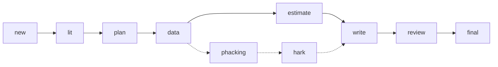

# econ-harness

Bộ khung làm nghiên cứu kinh tế ứng dụng bằng R cùng agent AI: từ tìm tài liệu, lập kế hoạch, làm sạch dữ liệu, ước lượng, đến viết bản thảo và phản biện.

- **Agent chính:** Claude Code chạy trong [Orca](https://github.com/stablyai/orca). Codex và opencode đọc `AGENTS.md`; omp là tuỳ chọn.
- **Di động:** repo không chứa đường dẫn tuyệt đối hay khoá API, nên clone ở đâu cũng chạy được.
- **An toàn dữ liệu:** agent không được ghi vào `data/raw`. Một hook chặn mọi lệnh ghi vào đó.

## Cài đặt

Windows là máy dùng chính:

```powershell
git clone https://github.com/<user>/econ-harness.git C:\econ
cd C:\econ
powershell -ExecutionPolicy Bypass -File .\setup-windows.ps1
```

Trên macOS (để chạy thử): `./setup-mac.sh`.

Cả hai script cuối cùng đều gọi `node harness/setup/setup.mjs`. Script này build MCP, sinh `.claude/`, cài gói R, đăng ký MCP và tự kiểm tra; chạy lại bao nhiêu lần cũng được. Hướng dẫn đầy đủ và checklist ở [docs/install-windows.md](docs/install-windows.md).

**Cần có:** R 4.6 (thêm Rtools46 nếu dùng Windows), RStudio, Quarto, Git, Node.js 18 trở lên. Python 3 chỉ cần khi import bảng xếp hạng tạp chí.

## Sử dụng

Mở workspace trong Orca, chọn agent Claude, rồi:

```
/ae-new fdi_vn        # tạo projects/fdi_vn từ template/ (một repo Git riêng)
```

Sau đó mở `projects/fdi_vn` thành một workspace riêng và làm theo các bước:



| Bước | Lệnh |
|---|---|
| Tạo project | `/ae-new <slug>` |
| Tài liệu, trích dẫn | `/ae-lit`, `/ae-cite <DOI>` |
| Thiết kế nghiên cứu | `/ae-plan`, `/ae-exogenous [câu hỏi]` |
| Dữ liệu, ước lượng | `/ae-data`, `/ae-estimate`, `/ae-consolidate` |
| Khám phá (exploratory) | `/ae-phacking [phạm vi]`, `/ae-hark [ID...]` |
| Viết, phản biện, xuất bản | `/ae-write <mục>`, `/ae-review`, `/ae-final [style]` |

Chi tiết từng bước, cách xuất bảng và render bản thảo: [docs/workflow.md](docs/workflow.md).

## Cấu trúc

```
AGENTS.md, CLAUDE.md     luật cho agent (mọi agent / riêng Claude Code)
harness/
  commands/ agents/ skills/   nguồn của 13 lệnh, 7 subagent, 9 skill
  claude/                     hook và settings.json cho Claude Code
  mcp/research-discovery/     MCP tìm tài liệu (Semantic Scholar, OpenAlex, Elsevier, SJR/ABDC)
  scripts/sync-agents.mjs     sinh .claude/ từ các nguồn trên
  setup/                      setup.mjs, install-packages.R
  tests/                      kiểm tra hook và audit
template/                khung project mà /ae-new chép sang projects/<slug>
docs/                    hướng dẫn cài đặt và quy trình
```

`.claude/` và `template/.claude/` là **file sinh tự động**. Muốn sửa lệnh, agent hay skill thì sửa trong `harness/`, rồi chạy:

```bash
node harness/scripts/sync-agents.mjs            # thêm --projects để cập nhật cả project đang có
node harness/tests/raw-guard.test.mjs
node harness/scripts/sync-agents.mjs --check
```

`projects/` và `data_hub/` không nằm trong repo này: mỗi project là một repo Git riêng.
