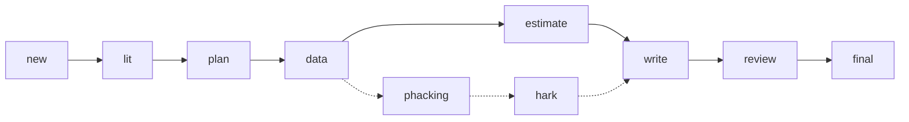

# econ-harness

Private research workspace: applied economics in R with Claude Code running inside Orca.

## Setup

```powershell
powershell -ExecutionPolicy Bypass -File .\setup-windows.ps1
```

Safe to rerun. It ends with a `PASS / WARN / FAIL` summary.

## Usage

Open the workspace in Orca, pick the Claude agent, then:

```
/ae-new fdi_vn        # create projects/fdi_vn from template/ (its own Git repository)
```

Open `projects/fdi_vn` as a separate workspace and work through the steps:



| Step | Commands |
|---|---|
| Create a project | `/ae-new <slug>` |
| Literature and citations | `/ae-lit`, `/ae-cite <DOI>` |
| Research design | `/ae-plan`, `/ae-exogenous [question]` |
| Data and estimation | `/ae-data`, `/ae-estimate`, `/ae-consolidate` |
| Exploration | `/ae-phacking [scope]`, `/ae-hark [ID...]` |
| Writing, review, release | `/ae-write <section>`, `/ae-review`, `/ae-final [style]` |

Details for each step, exporting tables and rendering the manuscript: [docs/workflow.md](docs/workflow.md).

## Layout

```
AGENTS.md, CLAUDE.md     rules for agents (all agents / Claude Code only)
harness/
  commands/ agents/ skills/   sources for 13 commands, 7 subagents, 9 skills
  claude/                     Claude Code hook and settings.json
  mcp/research-discovery/     literature MCP server (Semantic Scholar, OpenAlex, Elsevier, SJR/ABDC)
  scripts/sync-agents.mjs     generates .claude/ from the sources above
  setup/                      setup.mjs, install-packages.R
  tests/                      hook and audit tests
template/                project skeleton that /ae-new copies to projects/<slug>
docs/workflow.md         how each step works
```

`.claude/` and `template/.claude/` are **generated**. To change a command, agent or skill, edit it in `harness/`, then run:

```bash
node harness/scripts/sync-agents.mjs            # add --projects to update existing projects too
node harness/tests/raw-guard.test.mjs
node harness/scripts/sync-agents.mjs --check
```

`projects/` and `data_hub/` are not part of this repository: each project is its own Git repository.
