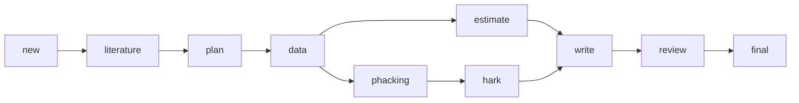

# Harness nghiên cứu kinh tế ứng dụng

Workspace di động: không có đường dẫn tuyệt đối, không chứa khoá API. Agent chính là **Claude Code chạy trong Orca**; Codex/opencode đọc `AGENTS.md`; omp là tuỳ chọn (`harness/install.ps1`). `data/raw` được bảo vệ bởi hook `.claude/hooks/ae-raw-guard.mjs` (Claude Code) và `harness/extensions/ae-raw-guard.ts` (omp).

## Cài đặt
- **Windows (đích chính):** `git clone` → `powershell -ExecutionPolicy Bypass -File .\setup-windows.ps1`. Chi tiết và checklist: [`docs/CAI-DAT-WINDOWS.md`](docs/CAI-DAT-WINDOWS.md).
- **macOS (chạy thử):** `./setup-mac.sh`.
- Cả hai cuối cùng gọi `node harness/setup/setup.mjs` (build MCP, sinh `.claude/`, cài gói R, đăng ký MCP, kiểm chứng). Chạy lại bất cứ lúc nào.

## Môi trường
R 4.6.x (+ Rtools46 trên Windows), RStudio, Quarto, Pandoc, Git, Node.js ≥ 18, Python 3 (chỉ để import xếp hạng tạp chí). Gói R: `harness/setup/install-packages.R` (spec ghim `contdid` 0.1.1, `ivDiag` 1.0.6, `fwildclusterboot` 0.14.3).

## Cấu trúc
| Đường dẫn | Vai trò |
|---|---|
| `AGENTS.md`, `CLAUDE.md` | Luật workspace (mọi agent) / bổ sung cho Claude Code |
| `harness/commands`, `agents`, `skills` | **Nguồn** 13 command, 7 subagent, 9 skill |
| `harness/claude/` | Nguồn hook + `settings.json` cho Claude Code |
| `.claude/`, `template/.claude/` | **Sinh tự động** bởi `harness/scripts/sync-agents.mjs` — không sửa tay |
| `harness/mcp/research-discovery` | MCP server (Semantic Scholar + OpenAlex + Elsevier + xếp hạng SJR/ABDC) |
| `harness/setup/` | `setup.mjs`, `install-packages.R` |
| `harness/tests/` | `audit-smoke.R`, `raw-guard.test.mjs` |
| `template/` | Khung project; `/ae-new <slug>` chép sang `projects/<slug>` (repo Git riêng, git-ignored) |

## Quy trình

| Chặng | Command |
|---|---|
| Project | `/ae-new <slug>` |
| Literature/citation | `/ae-lit`, `/ae-cite <DOI>` |
| Design | `/ae-plan` |
| Exploration / research directions | `/ae-phacking [scope]` |
| Exogenous-variation discovery | `/ae-exogenous [question/context]` |
| Results-first hypotheses | `/ae-hark [ID...]` |
| Data/estimate | `/ae-data`, `/ae-estimate`, `/ae-consolidate` |
| Writing/review/release | `/ae-write <section>`, `/ae-review`, `/ae-final [journal-style]` |

Chỉ thêm tài liệu qua `/ae-cite <DOI>`; kiểm chéo độc lập bằng `ae-citation-check`; xem `literature/citation_checks.csv`.

Nếu muốn chạy mô hình rồi viết lại giả thuyết theo kết quả nhất quán và vững, dùng `/ae-hark`: thực thi mô hình + robustness, so độ lớn/dấu/SE/mẫu/chẩn đoán, ghi ma trận bằng chứng, thêm giả thuyết `origin=post-results` vào PLAN §9a và viết lại QMD với nhãn exploratory. Giữ giả thuyết cũ và kết quả trái chiều; không trình bày phát hiện cùng mẫu như kiểm định độc lập hay nhân quả chỉ vì bền.

`/ae-phacking [path/scope/grid]` independently searches readable sources without `/ae-data`, PLAN, codebook or quality PASS. It explores numeric Y/X pairs, controls, labeled/designated proxies, candidate 2SLS IV triples, supported FE/inference, transforms, subsamples, and separately inventories potential policy/shock/threshold/assignment-based variation with evidence and assumptions. Candidate variation is not called exogenous until independently verified; IV relevance alone does not establish validity. Inputs are preserved; filters/transforms use copies. Full grid/script/log/RDS/report retain failures, nulls, design-only leads and not-run cells; no fixed cap. Results remain EXPLORATORY.
`/ae-exogenous [question/context]` is a separate design-discovery command: it defines the estimand, searches up to three documented assignment mechanisms, verifies policy/event facts against primary sources, and stress-tests IV/DiD/continuous-exposure DiD/RDD assumptions. It reports source facts, assumptions, threats, required data and unresolved evidence without fitting models or ranking candidates by p-value. It does not require a data-quality PASS and does not edit data, PLAN or manuscript; its dated assessment is saved under `output/logs/exogenous/`.

## Bảng kết quả
Mỗi script ước lượng xuất bảng hoàn chỉnh bằng `modelsummary` ngay khi chạy:
`ae_export_table(list("(1)" = m1, "(2)" = m2), "T2_baseline")` ghi `output/tables/T2_baseline.html` (mở trong Viewer/trình duyệt; chạy trong RStudio thì tự hiện ở Viewer), `T2_baseline.md` (Markdown) và `.rds` (để chèn bản thảo). Loại sai số chuẩn và số cluster đọc từ object mô hình.
**Luôn xem ở Viewer trước**: chạy script trong RStudio thì bảng vừa xuất tự mở trong Viewer; mở lại bằng `ae_view_table("T3_main")`. Render bản thảo bằng `render.R` ở gốc project (luôn render HTML và mở Viewer trước, DOCX chỉ khi bật `DOCX <- TRUE`): mở trong RStudio, chỉnh `DOCX`/`RUN_MODELS` ở đầu file rồi Source (Ctrl+Shift+S); hoặc `Rscript render.R` (HTML), `Rscript render.R docx` (HTML rồi DOCX bản cuối), `Rscript render.R html run` (chạy lại toàn bộ mô hình trước). Script dừng nếu bản thảo gọi bảng chưa được xuất.
Không tạo DOCX khi chạy script. Bản thảo `paper/manuscript.qmd` hiển thị bảng bằng `ae_table("T2_baseline")`; xem thường ngày bằng `render.R` (nút Render của RStudio cũng ra HTML nhưng bỏ qua bước kiểm tra bảng thiếu). Chỉ ở bản cuối mới chạy `Rscript render.R docx`; chỉnh style `paper/reference.docx` một lần trong Word. Cần gửi lẻ một bảng Word: thêm `docx = TRUE`.

## Vị trí
`data/raw` nguồn bất biến; `data/analysis.rds` dữ liệu phân tích; `data/codebook.csv` định nghĩa; `output/` kết quả; `paper/` bản thảo; `literature/` bằng chứng và kiểm chứng; `scratch/` thử nghiệm. Hướng dẫn cho từng phương pháp ở `harness/skills/ae-methods/references/`.
